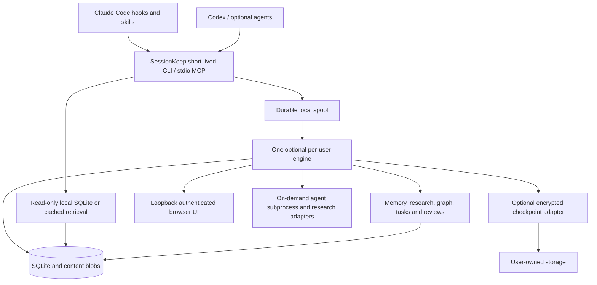

# Architecture — proposed baseline

## 1. System topology



Use one portable core executable with CLI subcommands and optional daemon mode. Hooks are short-lived commands; do not spawn or restart a server on every event. A service can be started once manually or by OS login supervisor, with explicit opt-in. CLI capture and basic recall do not depend on a successful HTTP request. MCP should be a short-lived stdio adapter using the same service interfaces; its failure must not block ordinary agent operations. Dashboard may be served on demand by the engine. Only optional external processes (Codex, parsers, embedding workers) run while needed.

## 2. Stack decisions to validate in Phase 0

| Layer | Proposed choice | Reason / tradeoff |
|---|---|---|
| Core | Go, standard library HTTP/CLI, context cancellation | Compiled portable distribution; simple concurrency; benchmark binary size |
| DB | SQLite via `modernc.org/sqlite` candidate | No external server; validate embedded SQLite version, FTS5, backup, locking on OS matrix |
| Search | SQLite FTS5 and exact indexed fields | Reliable offline baseline; semantic optional after evaluations |
| Graph | SQLite adjacency tables; Tree-sitter or native parser adapters | Deterministic extraction; WASM/native parser packaging spike; no required graph DB |
| Frontend | TypeScript, React, Vite, shadcn/ui/Tailwind candidates | Static assets embedded in executable; Node only build-time; browser UI |
| Graph UI | Cytoscape.js candidate, lazy loaded | Bounded subgraphs, no rendering all nodes |
| Agent API | Hook command + stdio MCP; Codex CLI non-interactive | Official mechanisms; no custom credential extraction |
| Sync | Local export, optional Restic adapter or vetted encrypted format + S3 API | Avoid crypto invention; snapshots first, multi-device writes later |
| CI | GitHub Actions, GoReleaser candidate | Platform builds, signatures, SBOM, reproducibility checks |

Use versioned protocol interfaces. Pin dependencies after actual validation, document licenses, supported OS and version matrix. No default AI provider or exact package versions assumed by this blueprint. Prefer pure Go core; optional native/WASM components may have their own distribution contracts.

## 3. Component boundaries

- `core/config`: user settings, OS directories, provider capabilities, feature flags. Secret references only; validate config atomically.
- `capture/spool`: adapt hook payload, project identify, filter/redact, write bounded durable event; no provider/network calls. On I/O failure return no blocking hook response, emit safe health metadata where possible.
- `ingest`: exclusive queue consumer, reconciliation of transcript offsets, transactionally insert idempotent events; unknown schemas quarantined after filtering, no unsafe replay.
- `store`: SQLite repositories with scope filters and typed transactions, content-addressed blobs, migrations/backups. Never expose generic SQL to agents or browser.
- `memory`: explicit instructions and evidence; derived observations, versioning, search, coverage.
- `research`: durable claims, retrieval sources, provider adapters, freshness rules and evidence checks. Network isolated.
- `graph`: deterministic parser, file fingerprints, indices and queries; semantic links provenanced separately.
- `tasks/reviews`: stable requirement IDs, plan versions, checkpoints, review snapshots, result validation, test evidence.
- `agents`: capability negotiation, approved subprocesses, structured output, job cancellation; no authority to auto-execute review text.
- `sync`: export and restore transactions, manifests, encrypted transport and conflicts; optional and separated from live DB.
- `web/api`: loopback server and auth, DTO validation, pagination, SSE, static frontend. Internal services callable independently of HTTP.
- `ops`: process supervisor, leases, job queue, diagnostics, metrics, backup and update lifecycle.

## 4. Local operation and recovery

Use OS-specific user data directories (Windows LocalAppData, macOS Application Support, Linux XDG data/state) and OS credential store. Database only on local supported filesystem. Spool uses uniquely named temp file in same directory followed by durable flush/rename; define Windows semantics and test power-loss boundaries. A count of acknowledged events means spool commit succeeded, not that downstream indexing finished. The ingest transaction inserts event, provenance and relevant job records with uniqueness constraints. Delete spool file only after commit; on crash replay safely. Periodic scanner repairs missed notifications. Restrict raw capture size and log dropped bytes/reasons without sensitive content. At terminal deadline return a neutral result; later transcript reconciliation recovers accessible permitted text, not guaranteed all events.

One writer service for DB; hooks read-only with small busy deadline, no migrations in hook path. Cache confirmed current instructions with version/digest and atomic replace; if cache stale show degraded state and do not misrepresent freshness. Worker lease acquired by OS-local lock or equivalent primitive; PID alone insufficient. Verify identity before restart or stop. Backoff after repeated crashes; manual repair available; no forced kill by port number. Durable job queue uses lease expiration and bounded retries, crash recovery and dead letter states. No busy polling; bounded queue size, storage quota and visible backpressure. Avoid silent data loss: notify once UI is available, reconcile from source where possible.

## 5. Data flows and state

Capture allowed event -> durable spool -> ingest -> raw permitted evidence -> extraction/optional enrichment -> indexed facts/graph -> recall with provenance. Research -> source fetch -> immutable evidence -> candidate claims -> version/freshness decision -> project/requirement links. Review -> fixed manifest -> permission check -> provider job -> validated output -> triage -> retest -> re-review if needed. Sync -> consistent snapshot -> encrypted objects -> immutable manifest -> atomic publish -> independent restore verification.

Cancellation: local jobs cooperative via context; on external subprocess cancellation stop process tree safely and record partial output/status. External operations requiring consent do not auto-resume blindly after crash. All timestamps UTC RFC3339; time observed vs received distinguished; no assumption that clocks across devices determine conflicts.

## 6. Proposed repository layout

```text
cmd/sessionkeep/                # CLI, daemon, hook, mcp entrypoints
internal/{config,capture,ingest,store,memory,research,graph,tasks,agents,reviews,sync,web,ops,security}/
internal/platform/          # OS-specific process, paths, keychain
migrations/                  # numbered SQL + tests
web/                         # React source, embedded build output
plugins/claude-code/         # .claude-plugin, skills, hooks, MCP config
integrations/codex/         # version/capability probes and adapter fixtures
installers/                  # platform packages, uninstall/rollback
fixtures/                    # strictly synthetic, sanitized
 tests/{integration,crash,security,evals,benchmarks}/
docs/                        # blueprint and implementation evidence
```

Maintain internal domain packages without cyclic dependencies. Define ports/interfaces at consumer boundary, adapters implement them, use dependency injection only where useful. Avoid creating empty frameworks for future modules. Frontend contracts generated or validated from API schema. OS-specific runners should use argv arrays not interpolated shells.

## 7. Initial performance targets (unmeasured)

Idle core RSS <=50 MiB target; idle CPU <1% of one logical core over 10 min; p95 hook <=100 ms on reference Windows machine (including process spawn); p95 cached startup <=500 ms; typical keyword retrieval <=300 ms at 100k records; 20 simultaneous sessions; installed core target <=50 MiB excluding browser/model/parser assets. Set explicit OS/hardware baseline in Phase 0. Quality remains first; measure and optimize, revise unrealistic targets through ADR, never remove relevant evidence to fake performance. Browser and optional worker resource usage measured separately.
