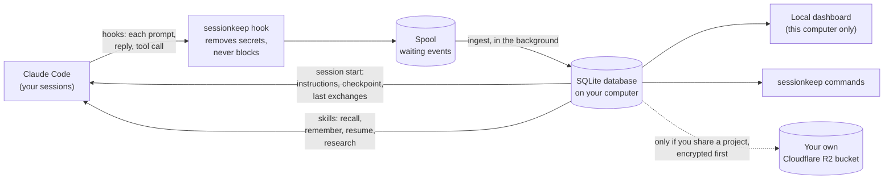
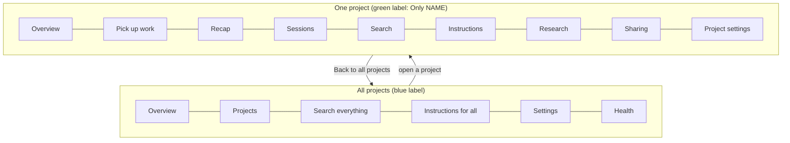
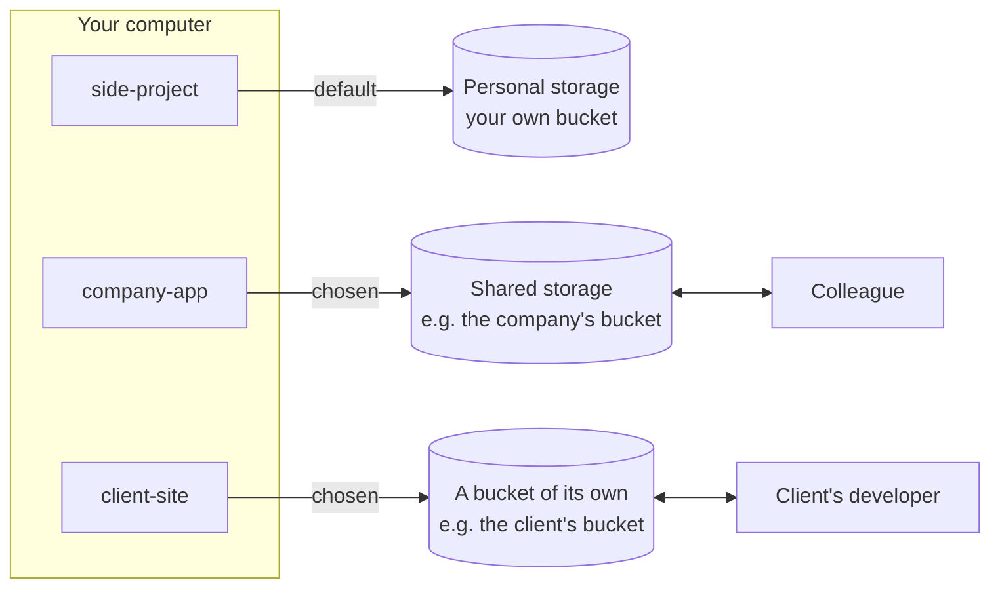
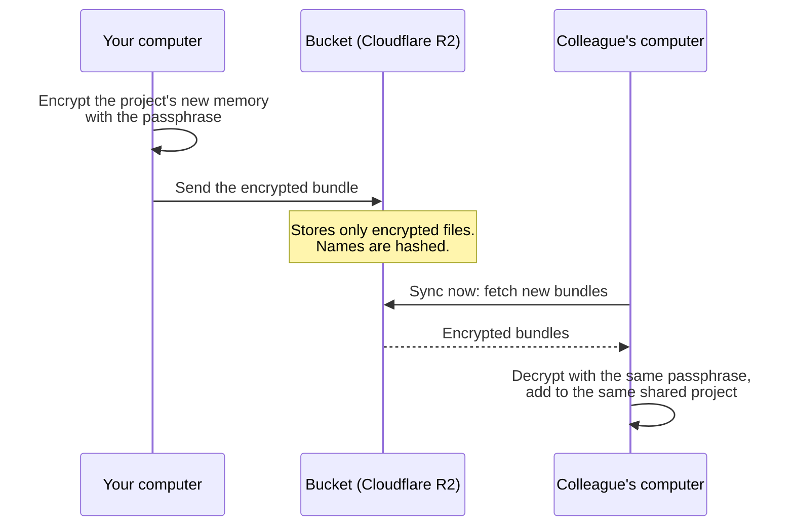

<div align="center">

# SessionKeep

**Developer memory for Claude Code that stays on your own computer.**

Every session you have with Claude Code is saved, searchable and handed back to the next one, so
work picks up where it stopped instead of starting from zero.

[](https://www.npmjs.com/package/sessionkeep)
[](LICENSE)


```
npm install -g sessionkeep
```

</div>

---

## The problem it solves

Claude Code forgets. When a session ends, or its context is compacted, what you decided, what
you asked it never to do again and where the work stood are gone. You explain the same things
again, in every session, in every project.

SessionKeep keeps that memory for you, **on your computer, in one file**, and gives it back to
Claude Code when it is useful: at the start of a session, after a compaction, when Claude looks
something up, or when you search for it yourself.

| Without SessionKeep | With SessionKeep |
|---|---|
| "Use pnpm, not npm" is said again in every session | Said once with `remember`, sent to every session word for word |
| After a compaction, the last exchanges are gone | The next session start carries them word for word |
| "Where was I yesterday?" means scrolling old chats | `resume` or the dashboard shows the last checkpoint and what changed since |
| "Why did we write this line?" has no answer | `why FILE:LINE` shows the conversation behind the commit |
| A colleague starts with nothing | They receive the project's memory, encrypted, from a bucket you own |

---

## How it works



**Why it is built this way**

- **One program, no servers.** SessionKeep is one Go program of about 20 MB. No database server,
  container, Python or Node is needed to run it (Node is used only by `npm install`). Nothing runs
  in the background for every terminal.
- **Capture can never break your work.** The hook writes to a spool and always exits successfully.
  If SessionKeep is broken, Claude Code carries on as normal and the events are stored later.
- **Secrets are removed before anything is written.** Keys, tokens and passwords are redacted at
  capture time, not afterwards.
- **Nothing is saved until you say so.** Each project is registered with a capture level you
  choose. There is no default level.
- **Nothing leaves your computer by default.** No telemetry, no account and no SessionKeep
  server. Sharing is opt-in, per project, encrypted on your computer, and goes to a bucket you own.

---

## Features, and why each exists

### Memory

| Feature | What it does | Why |
|---|---|---|
| **Capture levels** | `metadata` (no text), `conversation` (prompts, final replies, tool errors), `extended` (plus a short piece of tool output), or `off`, per project | You decide how much is kept, project by project |
| **Standing instructions** | `remember "Use pnpm"` is sent to every session, word for word. One Claude saves for you waits until you approve it on the dashboard | Rules you give once should never be paraphrased or lost, and nobody else's should slip in |
| **Checkpoints and resume** | `checkpoint "auth done, tests next"` stores where work stands with the Git branch and commit. `resume` prints it, warns if the code moved since, and adds the recent exchanges | Starting tomorrow should take seconds |
| **After a compaction** | The next session start carries the last exchanges word for word | A compaction summary loses detail; the original words don't |
| **Search** | `memory search "rate limit"` across one project or all of them, with exact matching and date filters | Find what was said, not what someone remembers was said |
| **Recall mode** | `asked` (Claude looks things up when needed, the default) or `automatic` (relevant earlier pieces come with every request) | Some projects want more context, some want less |
| **An error met before** | When a command fails with an error an earlier session met, Claude is told what was said then | The second time should be faster than the first |
| **Import earlier sessions** | `history import` brings in the Claude Code sessions you had before installing | Your memory starts full, not empty |

### Understanding your own work

| Feature | What it does | Why |
|---|---|---|
| **Recap** | `recap yesterday` or `recap week`: sessions, first request, last reply, checkpoints and commits | Stand-ups, timesheets, or just remembering |
| **File history** | `file src/auth.ts` lists the sessions that changed a file | See the reasoning behind a file, not just its diff |
| **Why** | `why FILE:LINE` or `why COMMIT` shows the conversation behind a change | Git says what changed; this says why |
| **Things you repeat** | `suggest` finds requests you made in nearly the same words in 3 or more sessions | Those are instructions waiting to be written down |
| **Summaries** (optional, off) | Short summaries of finished sessions, written through your own Claude Code sign-in, with a daily limit | Long sessions become quick to scan. Your own plan pays; nothing else |
| **Research** (optional, off) | Records a fact (an API limit, a price) with the page that says so and the date it was checked; stale facts are flagged at session start | Facts about the outside world go out of date; this says when |

### Control

| Feature | What it does | Why |
|---|---|---|
| **Pause, exclude, forget** | Pause a project, exclude a folder for good, or permanently delete a record, a project's captures or a whole project | Your data, your decision. Deletion shows what goes before it happens |
| **Export and import** | All your data in one file, and back | Move computers, keep backups |
| **Handoff file** | One project's instructions, checkpoints and (if you choose) sessions in one readable file for a teammate | Sharing without any cloud at all |
| **Cloud sharing** (optional) | Exchange a project's memory with colleagues through your own Cloudflare R2 bucket, encrypted with a passphrase | Teams stay in step without a third-party service |
| **Health checks** | `doctor` and the dashboard's Health page | When something is off, it says what and how to fix it |

---

## The dashboard

Run `sessionkeep dashboard` and open the sign-in link it prints. It runs on your computer only.
The menu has two levels, and every page says which one you are on.



- **Overview:** where you left off, this week's timeline, what needs you, latest sessions.
- **Projects:** add a project with **Choose folder** (works on Windows, macOS and Linux), import
  earlier sessions.
- **Settings:** new folders, Claude Code, summaries, cloud storage, web research.
- **Inside a project:** pick up work, read sessions, manage its instructions, share it, move it
  after renaming its folder, or delete it.

---

## Install and first steps

```bash
npm install -g sessionkeep      # installs the program and turns the Claude Code plugin on
```

Restart Claude Code, then tell SessionKeep what to remember:

```bash
cd your-project
sessionkeep project add . --capture conversation        # this project only
# or, for every new folder you open in Claude Code:
sessionkeep setup --auto-add auto --level conversation
```

That's it. Work in Claude Code as usual. Then try:

```bash
sessionkeep remember "Run the tests with pnpm test" --scope project --yes
sessionkeep checkpoint "Login works; next: password reset"
sessionkeep resume
sessionkeep memory search "password reset"
sessionkeep dashboard
```

More detail on installing (npm script notices, installing without setup):
[npm/README.md](npm/README.md). Remove with `sessionkeep uninstall` then
`npm uninstall -g sessionkeep`; your data stays unless you add `--purge-data`.

---

## Share projects through your own Cloudflare R2

Sharing is optional and off until you set it up. There is **no SessionKeep server**: each
computer talks directly to a bucket in a Cloudflare account you or your team own, and every
bundle is **encrypted on the sending computer** with a passphrase only the people sharing that
project know. Cloudflare sees encrypted files, never their contents.

### Three places a project can go



| Storage | Use it for | Set up |
|---|---|---|
| **Personal** | Your own projects, across your own computers | Once, in Settings. Every shared project goes here unless you choose otherwise |
| **Shared** | Projects you work on with a team, through the team's bucket | Once, in Settings |
| **A bucket of its own** | One project that needs a different bucket, such as one a client gave you | On that project's Sharing page; kept with that project only |

All three can be used at the same time. You can have as many projects as you like in each.

### How a sync works



Sync happens only when someone presses **Sync now** (or runs `sessionkeep team sync --yes`). It
receives first, then sends, and shows what it will do before doing it.

### Step 1: Create a bucket and a key in Cloudflare

Done once per bucket by whoever owns the Cloudflare account.

1. In the Cloudflare dashboard, open **Storage & databases > R2** (R2 must be enabled on the account).
2. Press **Create bucket** and name it, for example `sessionkeep-mine` or `acme-sessionkeep`.
3. On the R2 **Overview** page, press **Manage** next to **API Tokens**, then **Create Account API token**.
4. Permission: **Object Read & Write**. Under buckets, choose **Apply to specific buckets only**
   and pick your bucket.
5. Create it and copy three things: the **Access Key ID**, the **Secret Access Key** (shown only
   once) and the **S3 endpoint**, which looks like `https://<ACCOUNT_ID>.r2.cloudflarestorage.com`.

For a team bucket, make **one token per person**. To remove someone later, delete their token.
Colleagues do not need a Cloudflare account of their own.

### Step 2a: Personal storage (your own bucket)

1. Open the dashboard: `sessionkeep dashboard`.
2. Go to **Settings > Cloud storage**. Under **Personal storage**, press **Set up**.
3. Paste the endpoint, the bucket name and both keys, and type your name (colleagues see it).
4. Press **Save storage**. SessionKeep checks the bucket answers, then saves it. Nothing is sent yet.
5. Open a project (from **Projects** or the list in the menu) and go to its **Sharing** page.
6. Leave **Personal storage** selected. Type a shared name (like `side-project`) and a passphrase
   of at least 8 characters. Press **Turn sharing on**.
7. Press **Sync now** whenever you want to send and receive.

On your other computer, do the same with the **same bucket**, **same shared name** and **same
passphrase**: the two stay in step.

### Step 2b: Shared storage (a team's bucket)

1. Get a token for the team bucket from whoever owns the Cloudflare account (Step 1, one per person).
2. In **Settings > Cloud storage**, under **Shared storage**, press **Set up** and save it the same way.
3. On a project's **Sharing** page, choose **Shared storage**.
4. **The first person** makes up the shared name and passphrase. Everyone else types **exactly
   the same** shared name and passphrase on their own computer, with their own keys.
5. Each person presses **Sync now** to receive the others' work and send their own.

Your personal storage stays separate and is never touched by the team.

### Step 2c: A bucket of its own (one project, one bucket)

1. Get the endpoint, bucket name and keys for that bucket.
2. On the project's **Sharing** page, choose **A bucket of its own**.
3. Type the endpoint, bucket and keys there, then the shared name and passphrase. Press **Turn sharing on**.

Nothing is saved in Settings: the bucket belongs to that one project.

### From the command line instead

Keys and passphrases are read from the environment, never from the command line, so they don't
end up in your shell history.

```powershell
# Windows PowerShell (on macOS/Linux use: read -rs VAR; export VAR)
$env:SESSIONKEEP_TEAM_ACCESS_KEY = Read-Host "Access Key ID"
$env:SESSIONKEEP_TEAM_SECRET_KEY = Read-Host "Secret Access Key"
$env:SESSIONKEEP_TEAM_PASSPHRASE = Read-Host "Passphrase"

# Personal storage, then share this project through it
sessionkeep team storage --endpoint https://<ACCOUNT_ID>.r2.cloudflarestorage.com --bucket sessionkeep-mine --from "Your Name"
sessionkeep team connect --name side-project

# Shared storage, and a project through it
sessionkeep team storage --storage shared --endpoint URL --bucket acme-sessionkeep
sessionkeep team connect --name company-app --storage shared

# A bucket of its own
sessionkeep team connect --name client-site --endpoint URL --bucket client-bucket

sessionkeep team sync          # shows what would be received and sent
sessionkeep team sync --yes    # does it
sessionkeep team list          # which storage each project uses
```

### Good to know

- **What is sent:** the project's instructions, checkpoints and session text. **Code is never
  sent**; use Git for that. `team push --no-sessions` leaves sessions out.
- **A teammate's instructions wait for you.** Instructions you receive are listed under
  **Instructions > Waiting for you** and reach Claude only once you approve them. Claude is told
  which checkpoints, sessions and instructions came from a teammate.
- **One passphrase per project.** One project's passphrase cannot open another project's bundles,
  even in the same bucket.
- **Keys stay on your computer** and are never shown again: protected for your user by Windows,
  and in a file only you can read on macOS and Linux.
- **Forgot the passphrase?** A computer still connected can show it again (**Show passphrase**
  on the Sharing page, after a confirmation, or `sessionkeep team passphrase --yes`). If nobody has
  it, the sent bundles cannot be opened by anyone: share again under a new name and passphrase.
  Your own saved memory is never affected.
- **SessionKeep never deletes anything from a bucket.** Forgetting a storage or stopping sharing
  only changes your computer.
- Built and tested against Cloudflare R2. Other S3-compatible services may work (`--region`).

---

## Privacy and security in one list

- Everything is stored in one SQLite database in your user folder (`sessionkeep paths` shows where). The database is not encrypted: it is protected by your account's file permissions, and full-disk encryption (BitLocker, FileVault, LUKS) protects it on a lost or stolen computer.
- Secrets are redacted before they are written. Excluded folders are never captured.
- No telemetry, no account, no SessionKeep server.
- The dashboard listens on this computer only and needs a one-time sign-in link.
- Optional features that use the network or your Claude plan (summaries, web research, cloud
  sharing) are **off until you turn them on**, and each says what it does before it starts.
- Shared bundles are encrypted with [age](https://age-encryption.org) on your computer before upload.
- Claude cannot approve lasting changes for you. An instruction it saves, or one a teammate sends,
  waits for your approval on the dashboard, and commands that delete data, sync or turn features on
  are refused when Claude runs them. This protects against text Claude reads (a web page, a README)
  telling it to plant an instruction.

Report a vulnerability: [SECURITY.md](SECURITY.md).

---

## For contributors

SessionKeep is written in Go (no CGO). Build and run the full check with `bash scripts/check.sh`;
build the npm package with `bash scripts/npm-pack.sh VERSION all`.

| Read | For |
|---|---|
| [STATUS.md](STATUS.md) | What is built, what was tested, what is not verified yet |
| [DECISIONS.md](DECISIONS.md) and [docs/adr/](docs/adr/) | Why things are the way they are |
| [PRODUCT_SPEC.md](PRODUCT_SPEC.md), [ARCHITECTURE.md](ARCHITECTURE.md) | Requirements and the design of the program |
| [docs/](docs/) | Data model, memory, research, sync, security, dashboard, interfaces, install, tests |
| [ROADMAP.md](ROADMAP.md), [phases/](phases/) | What comes next |
| [CONTRIBUTING.md](CONTRIBUTING.md), [CLAUDE.md](CLAUDE.md), [AGENTS.md](AGENTS.md) | How to work on it (people and coding agents) |

Precedence when documents disagree: the owner's newest decisions, then product requirements and
security rules, then approved ADRs, then detailed contracts. Conflicts are recorded, not hidden.

## Licence

[MIT](LICENSE). Licences of the software compiled into the program are listed in
`THIRD_PARTY_NOTICES.txt` inside the npm package.
